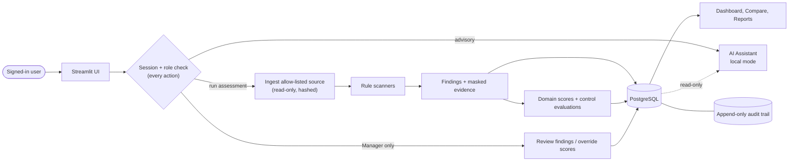
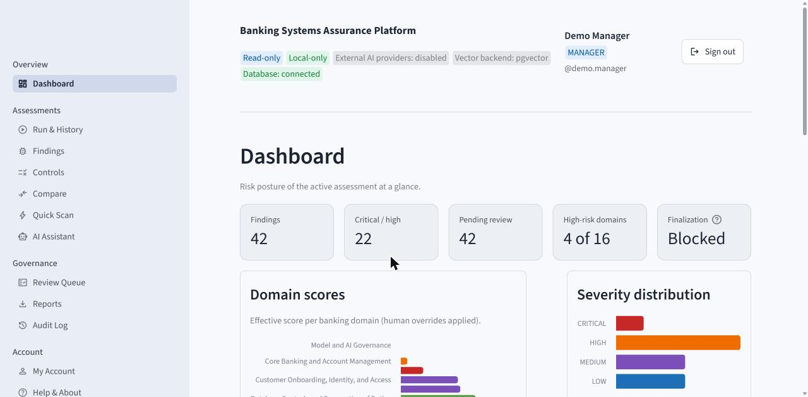
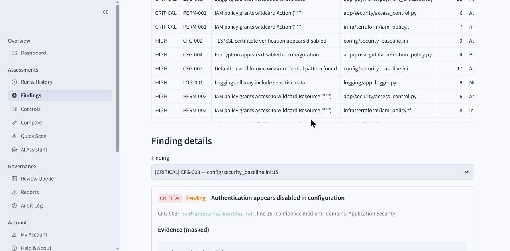
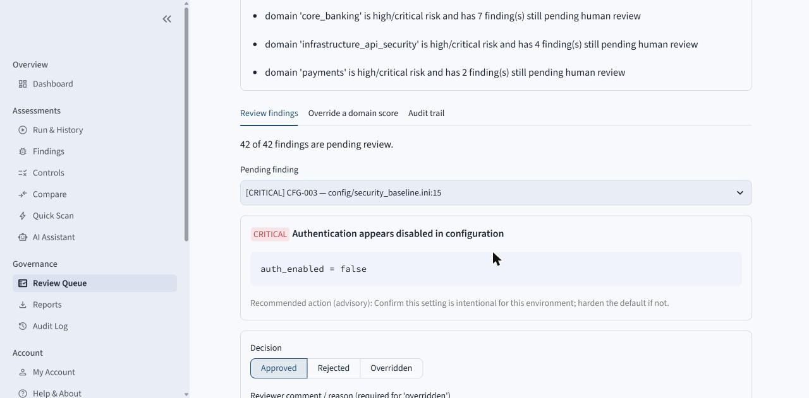
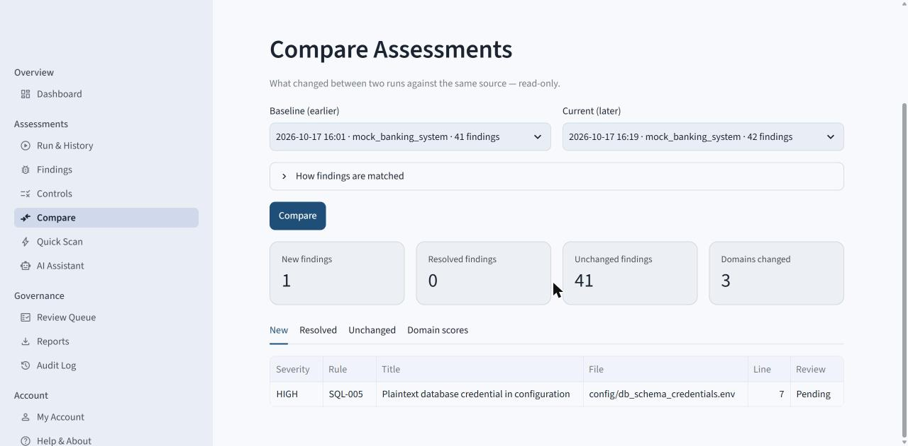

# Banking Systems Assurance Platform

## What is it?

A local, read-only assurance tool for banking software. It scans a codebase you point it at, maps what it finds to banking domains and controls, scores each domain, and gives a human reviewer a controlled way to approve findings and adjust scores. Every step is recorded in an append-only audit trail.

It is meant for engineering, security, and assurance teams who need a repeatable, evidence-backed view of how a banking system's code and configuration measure up — without the tool ever changing the system it inspects.

Main capabilities:

- **Read-only scanning** of an allow-listed local directory or ZIP archive, with a before/after hash proving nothing was modified.
- **Deterministic checks** for exposed secrets, PII, unsafe SQL, insecure configuration, broad permissions, audit gaps, and sensitive logging. Secrets and PII are masked before anything is stored or shown.
- **Scoring and control evaluation** across 16 banking domains (payments, core banking, identity, credit, fraud, and others) against a built-in catalog of 8 controls.
- **Human review**: managers approve, reject, or override findings and override domain scores with a written justification. A finalization check blocks sign-off while high-risk findings are still pending.
- **Comparison** of two runs of the same source: new, resolved, and unchanged findings and domain-score changes.
- **Reports** in JSON, Markdown, and CSV.
- **Sign-in with three roles** (Employee, Manager, Admin) enforced on the server.
- An optional **AI Assistant** that explains existing results. It is advisory only and runs in a local, deterministic mode.

The repository ships two **synthetic** banking systems to scan: `mock_banking_system/`, with deliberately planted problems (42 findings), and `reference_banking_system/`, a small well-governed contrast case. Neither contains real customer data or real credentials.

## Why does it exist?

Reviewing banking code for risk is usually manual and hard to repeat: findings live in spreadsheets, the evidence behind them is lost, and nobody can later show who accepted which risk and why. This platform keeps the whole chain together — the evidence, the finding, the score it affected, the person who reviewed it, and the reason — so an assessment can be repeated, compared with the last one, and defended in an audit. Automated checks do the repetitive work; decisions stay with an authorized human.

## How does it work?

1. A signed-in user picks a source: one of the synthetic systems, or a path inside the configured allow-list.
2. The source is validated and hashed, then scanned by deterministic rule scanners. Nothing is executed and nothing is written to the source.
3. Findings (with masked evidence) are mapped to banking domains. Each domain is scored and each control is evaluated.
4. Everything is stored in PostgreSQL and summarized on the dashboard.
5. A Manager reviews findings and, if needed, overrides a domain score with a justification. Overrides add a new score row; the original is kept.
6. Users export reports or compare the run with an earlier one. Every action is attributed to the signed-in user in the audit trail.



The AI Assistant only reads stored results and writes an audit entry; it has no path to change a finding, a score, or a review.

## Quick start

**Prerequisites:** Docker Desktop with Docker Compose v2. Run commands from the repository root (examples use PowerShell).

1. Create the environment file and choose a database password. Compose reads `POSTGRES_PASSWORD` from your shell on every `up`, and the value is fixed when the database volume is first created, so use the same value every time (or store it as a user environment variable):

   ```powershell
   Copy-Item .env.example .env
   $env:POSTGRES_PASSWORD = "choose-a-long-random-value"
   ```

2. Build and start:

   ```powershell
   docker compose -f deployment/docker-compose.yml up -d --build
   ```

   Database migrations run automatically on start. Open <http://localhost:8501>.

3. Create the first administrator. There is no default account. Either enter the password interactively:

   ```powershell
   docker compose -f deployment/docker-compose.yml exec app python -m scripts.create_admin --username your.name --display-name "Your Name"
   ```

   or copy `admin.credentials.example` to `admin.credentials` (ignored by Git and Docker), fill it in, and pipe it in:

   ```powershell
   Get-Content admin.credentials | docker compose -f deployment/docker-compose.yml exec -T app python -m scripts.create_admin --credentials-file -
   ```

4. Sign in as the administrator and add other users under **Administration → Users**. New users get a temporary password and must change it at first sign-in.

5. Stop without losing data:

   ```powershell
   docker compose -f deployment/docker-compose.yml down
   ```

   Do not add `-v` unless you intend to delete the database.

Optional, for demos only: `docker compose -f deployment/docker-compose.yml exec app python -m scripts.seed_demo_users --demo` creates one synthetic account per role with random passwords printed once.

More detail: [docs/OPERATIONS.md](docs/OPERATIONS.md).

## Roles

| Capability | Employee | Manager | Admin |
| --- | :-: | :-: | :-: |
| View dashboard, assessments, findings, controls, comparisons | ✓ | ✓ | ✓ |
| Run Full Assessments and Quick Scans | ✓ | ✓ | ✓ |
| Use the AI Assistant (advisory) | ✓ | ✓ | ✓ |
| Review findings and override domain scores | — | ✓ | — |
| Export reports | — | ✓ | ✓ |
| View the platform audit log | — | ✓ | ✓ |
| Manage users, view system configuration | — | — | ✓ |

Admins deliberately cannot approve findings or override scores (separation of duties). Permissions are enforced in the service layer, not just hidden in the UI. Details: [docs/SECURITY.md](docs/SECURITY.md).

## Screenshots

All screenshots use the synthetic mock banking system and demo accounts.


*Dashboard: headline counts, finalization status, and per-domain scores for the active assessment.*


*Findings & Evidence: filterable findings with masked evidence and advisory recommendations.*


*Review Queue (Manager): finalization blockers and the review form; the reviewer is always the signed-in user.*


*Compare: an earlier run against a later run of the same source — one new finding, 41 unchanged.*

## Technical overview

Python 3.11, Streamlit (multipage UI), SQLAlchemy with Alembic migrations, PostgreSQL 16 (pgvector image), Docker Compose. Passwords use the standard library's scrypt; there is no separate API server.

- [docs/ARCHITECTURE.md](docs/ARCHITECTURE.md) — components, data flow, storage, AI behavior
- [docs/OPERATIONS.md](docs/OPERATIONS.md) — configuration, running, users, troubleshooting
- [docs/SECURITY.md](docs/SECURITY.md) — authentication, permissions, sessions, audit, limitations
- [docs/VERIFICATION.md](docs/VERIFICATION.md) — how to test, and what was checked

## Limitations

- **Local use only.** Both ports are bound to `127.0.0.1` and the UI is served over plain HTTP. Configure HTTPS (for example a TLS-terminating reverse proxy) before allowing access from any other computer or the internet.
- **No MFA, no SSO.** Accounts are local to the platform.
- Detection is pattern-based and not exhaustive; results support a review, they do not replace one.
- The external AI provider adapters are not implemented; the assistant always runs in local mode.
- This is a portfolio-grade proof of concept. It is not production-ready and makes no claim of regulatory compliance or security certification.
